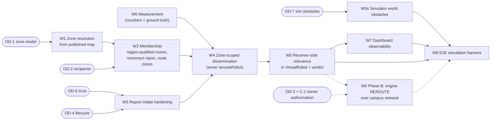

# Implementation readiness and test plan: DTARO zone coordination for the simulated fleet

Audited at `5e94a1a`, 2026-10-22. **This document is a plan.** It writes no code and settles no architecture choice. Each item marked **PROPOSAL** is a candidate for the owner to accept, change or reject.

Sources: [`CURRENT_IMPLEMENTATION_MAP.md`](CURRENT_IMPLEMENTATION_MAP.md) (**MAP**) and [`DTARO_GAP_ANALYSIS.md`](DTARO_GAP_ANALYSIS.md) (**GAP**).

---

## 1. Constraints that bound every option

| # | Constraint | Source | Consequence |
|---|---|---|---|
| C-1 | **The V1 assignment engine is frozen** (`78b4712`): no engine change without a new concrete production defect or an explicit owner decision | owner decision, 2026-10-02 (project memory) | Anything that touches `src/engine/**` or `src/workers/**` (a `REROUTE` producer, commit/outbox, F27/pricing) needs owner authorisation **first** |
| C-2 | **ADR-28 is frozen**: region ⊃ zone ⊃ cell, containment **by published assignment**, never query-time geometry | `docs/adr/ADR-28-spatial-hierarchy.md` | A "DTARO zone" built as a new bounding-box or grid concept would be a second spatial architecture. The prompt forbids that, and ADR-28 makes it a defect |
| C-3 | **ADR-27**: every external side effect via an outbox row in the same transaction as the guarded write | `docs/adr/ADR-27-command-emission.md` | A replan that moves a robot must be a fenced, outboxed command, never a raw emit or a cache rewrite |
| C-4 | **"Priced = driven = drawn" / F3**: completion is graded against the OFFER's commanded corridor | `tasks.controller.js:483-519`; `dtaro.handler.js:790-804` | A route change that does not also change the commanded corridor turns a correct delivery into `VERIFYING` |
| C-5 | **`gate:legacy`** forbids `costEvaluator`/`robotValidator`/`taskAssignment`/`taskRecovery` | `tools/gates/checkLegacyRetirement.js` | The paper's allocation half is out of scope by construction |
| C-6 | The physical robot is not a prerequisite. Simulation is the first target | prompt §2 | New robot-facing events must be additive and safely ignorable by the Pi |
| C-7 | Verification uses a disposable PostgreSQL, never Neon or port 5432 | project practice (memory `reference_disposable_postgres_verification`) | The E2E harness provisions its own database |

---

## 2. Decisions that require owner input (default: do not proceed)

| ID | Question | Options found in the evidence | Audit observation (not a decision) |
|---|---|---|---|
| **OD-1** | What *is* a DTARO zone? | (a) **Engine zone**: published `CellAssignment.zoneId` within a region (ADR-28 compliant; campus isolation by construction). (b) Legacy bbox `Zone` (contradicts ADR-28 rule 1; first-campus seeding). (c) A derived H3 parent cell (new semantics; must still be published to satisfy ADR-28) | (a) is the only option that adds no spatial architecture. Today V1 publishes **one** zone (`rnsit-z1`), so zone scope would equal campus scope until a multi-zone map is published. That publish is a configuration act with approvers, as in `bootstrapV1Environment` |
| **OD-2** | Who receives an alert? | (i) the paper: current-zone occupants only; (ii) the August plan: current-zone occupants ∪ robots whose **active route traverses** the zone; (iii) route-intersecting robots in the region only | The historical communication audit ruled (i) DO NOT IMPLEMENT (silent false negatives). (ii) keeps zone rooms as the addressing primitive and has no such miss class [I]. Choose after measuring (W0) |
| **OD-3** | Who replans, and how is the new route authorised? | (A) Robot-local A* as in the paper: breaks C-4. (B) Robot detects relevance and requests; the **engine** computes a route over the campus network avoiding the obstacle and commits a fenced `REROUTE` that also updates the commanded corridor (C-1, C-3). (C) Robot holds safely and escalates via A8 (operator queue); no autonomous replan in V1 | (B) is the only option that satisfies C-3/C-4 *and* replans, and it requires lifting C-1 for a bounded change. (C) needs no engine route change. The engine does own lease renewal and stall supervision, so the effect of a hold on those must be specified |
| **OD-4** | Obstacle lifecycle | Clock TTL (as today) vs `ACTIVE → STALE → RECHECK_REQUIRED → CLEARED` on evidence or operator action (August plan §9) | Clock expiry resolves unknown → clear (permissive). The engine elsewhere resolves unknowns the safe way |
| **OD-5** | Report trust | Accept as-is (today) vs plausibility: reported point within R m of the reporter's last accepted fix, inside the reporter's region / delivery domain; severity advisory only | DO NOT ADD #6 (historical): agent severity must not become a hazard class |
| **OD-6** | Campus authority for a robot | `Robot.campusId` (nullable) vs engine region (`Agent.regionId` or observed region, shard mirror) | The engine region is always present for an indexed robot; `campusId` can be null |
| **OD-7** | Simulator obstacle model | Keep the random self-report vs a deterministic **world obstacle** (seeded, placed on network edges) that a robot encounters when its path reaches it | A random self-report cannot produce a meaningful "should another robot have been warned?" ground truth |
| **OD-8** | Who sees obstacles on the dashboard | SUPER_ADMIN only (today) vs campus ADMIN for its campus | An open RBAC decision recorded 2026-10-21 |
| **OD-9** | JSSATE in scope for DTARO V1? | RNSIT only vs RNSIT + JSSATE | JSSATE has no engine region/cover in any bootstrap tool, and D1 coverage is blocked by governance (memory). Campus-isolation tests can still use two synthetic regions |

---

## 3. Smallest safe end-to-end path for simulated robots

Two phases. **Phase A needs no engine change** and delivers observed obstacle → validated → stored → zone-scoped delivery → receiver-side relevance → measured → displayed (stages 1–6 and 10). **Phase B** adds safe replanning (stages 7–9) and starts only after OD-3 and C-1 are resolved.

### 3.1 Work items and dependencies

### 3.2 Recommended order

| Order | Item | Phase | Engine change? | Summary |
|---|---|---|---|---|
| 1 | **W0 Measurement** | A | No | Count everything first, so later steps are evaluated rather than asserted |
| 2 | **W1 Zone resolution** | A | No (reads the pinned snapshot) | Map a point to `{regionId, zoneId}` via the published map; a multi-zone RNSIT map is published only under OD-1 |
| 3 | **W3 Intake hardening** | A | No | Validate, deduplicate, region-check, lifecycle |
| 4 | **W2 Membership** | A | No | Region-qualified zone rooms, reconnect rejoin, optional route-zone subscriptions |
| 5 | **W4 Dissemination** | A | No | Emit to the zone room(s) of the obstacle's region; remove the fleet scan and the `rerouteRobot` edge |
| 6 | **W5 / W5s Simulator** | A | No | Receiver-side test and verdict; deterministic world obstacles |
| 7 | **W7 Dashboard** | A | No | Markers, zones, per-alert counts |
| 8 | **W8 E2E harness** | A, then B | No | Prove Phase A on a composed server |
| 9 | **W6 Replanning** | B | **Yes**, after OD-3 + C-1 | Fenced `REROUTE` with an updated corridor; hold + escalate when no path exists |

### 3.3 Modules likely to be extended (with evidence)

| Item | Existing module | Why this module (evidence) |
|---|---|---|
| W0 | `Backend/src/services/metrics.service.js` (`obstacles.active` gauge `:41-49, 84-85`); `Backend/src/config/logger.js` `rootLogger.obstacle` (`:479+`) | The existing metrics snapshot and obstacle log line |
| W1 | Pattern of `Backend/src/workers/indexMaintainer.worker.js:181-191` (`cells.cellForPoint` → `hierarchy.indexMap(snapshot.spatial).resolve`) | Already resolves a position to a region through the published map without query-time geometry |
| W1, W2 | `Backend/src/services/zoneManager.service.js` (`assignRobotToZone`, `applyZoneChangeSideEffects`, `updateSocketZoneRoom`) | The live membership hook on telemetry (`telemetry.handler.js:1111-1167`) and AUTH (`robot.handler.js:1092-1102`) |
| W2 (route zones) | `Backend/src/sockets/handlers/offer.handler.js` `publishAssignment` (`:261-320`); the OFFER `stopSequence[].path` | The point where the accepted priced route is known server-side; already writes the route cache |
| W3 | `Backend/src/sockets/handlers/dtaro.handler.js` `OBSTACLE_REPORT` (`:118-153`); `Backend/src/services/ekb.service.js` | The existing intake and store |
| W4 | `Backend/src/services/alertDissemination.service.js`; `Backend/src/services/commandDispatcher.service.js` | The existing producer; the dispatcher already does presence checks and retry for robot events |
| W5 | `Backend/src/simulation/VirtualRobot.js` (`_registerHandlers` `:1106-1135`, `activePath`, `_onRerouteAlert` `:2347`) | The simulator holds the executing priced path |
| W5s | `Backend/src/simulation/VirtualRobot.js` `_maybeReportObstacle` (`:3882-3901`); `simulationConfig.js`; `random.js` | Existing seeded, rate-controlled obstacle stream |
| W6 | `Backend/src/simulation/campusTraversalNetwork.js` (`treeFrom` `:233-257`, `route` `:319+`); `Backend/src/engine/dispatch/offers.js`; `Backend/src/engine/commitment/fencing.js` (`REROUTE` `:62`); `executionGeometry.attachPricedPaths`; `dtaro.handler.readCommandedCorridor` | Router, command envelope and corridor reader already exist; only the producer and the blocked-set option are missing |
| W7 | `Frontend/src/context/AppProvider.jsx` (`:1162-1206`), `Frontend/src/lib/obstacleAlert.js`, `Frontend/src/features/maps/**`, `Backend/src/sockets/dashboardBroadcast.js` | The existing handlers, the map, and the campus-scoped broadcast |
| W8 | `Backend/tools/verify/*` (e.g. `v1CorePath.js`, `step4SimulationBehaviour.js`) | The project's established live-harness style |

### 3.4 Genuinely new contracts (PROPOSALS only)

| Proposal | Shape (illustrative) | Rationale |
|---|---|---|
| P-1 `OBSTACLE_ALERT` server → robot (zone room) | `{ obstacleId, version, regionId, zoneId, cellId, lat, lon, radiusM, severity (advisory), state, reportedAt, expiresAt }` | A **new** name. `REROUTE_ALERT` already means "here is `newPath`" to the simulator and to the operator path; reusing it with a third shape repeats B-3 |
| P-2 `OBSTACLE_ALERT_RESULT` robot → server | `{ obstacleId, version, commitmentId?, relevant: boolean, checkedAt }` | Receiver-side relevance becomes measurable (paper Table VII's "passing the route test") |
| P-3 Active-obstacle replay on AUTH / zone entry | The server sends the current `ACTIVE` obstacles for the robot's zones | Closes the reconnect and late-join gaps |
| P-4 Obstacle record with merge key and lifecycle | Key = (regionId, fine cell, window); `version`, `reportCount`, `reporters`, `state` | Dedup, ordering, and evidence-based clearing |
| P-5 (Phase B) `REROUTE` producer | Fenced mission command via the outbox, with the new per-stop `path` and the corridor update in the same transaction | The only form compatible with C-3/C-4 |

---

## 4. Acceptance criteria

### 4.1 Campus isolation

- AC-CI-1: An obstacle whose point resolves to region R is delivered **only** to robot sockets whose server-computed region is R. Zero deliveries to another region, even when two regions publish identically named or numbered zones.
- AC-CI-2: A report whose point is outside the reporter's region (or outside every published region) is refused with a named reason and counted.
- AC-CI-3: Room names embed the region identity (for example `zone:{regionRowId}:{zoneId}`). A test with two regions sharing a local zone label proves no cross-delivery.
- AC-CI-4: Dashboard obstacle and zone events continue to pass through `dashboardBroadcast`. A campus ADMIN receives them only if OD-8 allows, and then only for its campus.

### 4.2 Zone boundary and membership

- AC-ZM-1: Membership is derived from the **published** map (OD-1 (a)). A robot inside the region but in an unassigned cell is reported as unassigned, never guessed.
- AC-ZM-2: Crossing a boundary yields exactly one leave and one join, and one membership event.
- AC-ZM-3: A reconnect at any time (including within the registry TTL) restores every zone room the robot should be in.
- AC-ZM-4 (if OD-2 (ii)): Route-zone subscriptions are added at OFFER_ACCEPT from the commanded path's cells and removed at settle, withdraw, recall or abort.

### 4.3 Obstacle report and notification

- AC-ON-1: Authentication, rate limit and schema as today, plus OD-5 plausibility. Every refusal carries a reason code and a counter.
- AC-ON-2: Duplicate reports within the merge window update one record (`reportCount`, `version`) and do not re-notify unless the state changes.
- AC-ON-3: Exactly one zone-room emit per affected zone per state change. No fleet-wide enumeration on the report path.
- AC-ON-4: `alertDissemination` no longer calls `rerouteRobot` (the edge is severed, not left unreachable).

### 4.4 Route intersection and selective replanning

- AC-RI-1: The receiver tests the **remaining** portion of its current executing path. Geometry is direction-independent (point-to-segment distance ≤ `radiusM`, or route-cell membership). The SW–NE case from probe P2b is detected.
- AC-RI-2: A robot whose route does not intersect takes no navigation action and reports `relevant:false`.
- AC-RI-3: A robot with no active route reports `relevant:false` (or does not report, per contract) and takes no action.
- AC-RP-1 (Phase B): An affected robot's new route comes from the campus network with the obstacle's edges excluded; it is delivered as a fenced `REROUTE`; the commanded corridor read by `readCommandedCorridor` equals the new route; completion grades SUFFICIENT on a clean run.
- AC-RP-2 (Phase B): No feasible route → no straight line; the robot holds; A8 escalation reaches the operator queue; the Leg's state is consistent with the supervisor.
- AC-RP-3 (Phase B): A `REROUTE` carrying a stale fence or sequence is refused by the simulator (already tested at the protocol level; re-prove end to end).

### 4.5 Expiry, duplicates, stale events, disconnect, recovery

- AC-LC-1: Lifecycle transitions follow OD-4 and are emitted to recipients and the dashboard, versioned.
- AC-LC-2: A receiver ignores an alert whose `version` is lower than one it already holds.
- AC-LC-3: An alert issued while a robot is disconnected is delivered by replay (P-3) on reconnect, if still `ACTIVE`.

---

## 5. Tests

### 5.1 New unit / integration tests (PROPOSALS)

| Area | Test | Mirrors finding |
|---|---|---|
| Intersection geometry | Perpendicular, parallel-through-point, collinear, route ending inside the radius, route passing within/outside the buffer, an antimeridian-free local frame | P2a/P2b |
| Dissemination | Zero `robots:all` enumeration on the report path (spy); zone-room emits only; region filter; `rerouteRobot` never required/called | P1/P1b, B-5/B-6 |
| Membership | Reconnect within TTL rejoins (fails on the current tree); boundary crossing; unassigned cell; route-zone add/remove on OFFER lifecycle | P5 |
| Intake | Plausibility refusal; out-of-region refusal; duplicate merge; severity stays advisory | P2c, P6 |
| Lifecycle | Version monotonicity; expiry/clear event; replay on AUTH | P7 |
| Simulator | `VirtualRobot` handles `OBSTACLE_ALERT` → verdict; non-intersecting → no state change; world obstacle seeded deterministically, independent of the speed stream (`random.js` discipline) | P3 |
| Cross-campus | Two regions with identical local zone labels; no cross-delivery | AC-CI-3 |

Each new test should be shown to **fail on the current tree** before the change. This is the project's established "fails on BEFORE" discipline (e.g. FS sync hardening, F3).

### 5.2 Assignment-engine regression (must stay green)

- `npm run gates` (all eight build gates, `gate:legacy` included).
- `npm run test:engine`, `npm run test:legacy`, and the focused suites run in this audit: `tests/engine/dispatchAgentProtocol.test.js`, `dispatchSchema.test.js`, `v1SimulationIsolation.test.js`, `routingSimulationProducer.test.js`, `tests/unit/tasks/tasksControllerRerouteEngine.test.js`, `tests/unit/tasks/dtaroHandlerTaskComplete.test.js`, `tests/unit/dtaro/zoneLocality.test.js`, `tests/unit/redis/liveRobotIndex.test.js`.
- `npm run verify:v1CorePath` and the existing simulation harnesses `verify:step4`/`verify:step5` against a disposable database. Note: `verify:step4` has one known pre-existing failure (40/41) per project memory.
- Phase B additionally: the V1 regression gate in the runbook (10 robots × 10 and × 20 tasks, failure scenario) must be unchanged when no obstacle is present.

### 5.3 Simulation end-to-end (W8, PROPOSAL)

A `tools/verify/` harness in the existing style that boots the composed `server.js` against a disposable PostgreSQL, bootstraps the RNSIT world, and starts N simulated robots with `obstacleProbability = 0`. It then places one deterministic obstacle on a known network edge and asserts, per alert:

| Measured | Expected (Phase A) |
|---|---|
| reports accepted / refused (by reason) | as scripted |
| zone recipients | robots in the zone (and in its route zones, if OD-2 (ii)) |
| delivered | equals recipients currently connected |
| relevant (receiver verdict) | exactly the robots whose remaining route crosses the obstacle (ground truth from the harness) |
| missed (ground truth relevant but not notified) | 0 for OD-2 (ii); measured for OD-2 (i) |
| replans | 0 (Phase A); equals relevant-and-replannable (Phase B) |
| tasks completed SUFFICIENT | all, with and without the obstacle (Phase B: also the rerouted ones) |
| cross-region deliveries | 0 |

### 5.4 Dashboard observability checks

- An obstacle marker appears at the reported point with state, severity (labelled advisory), reporter, age and expiry, and disappears or changes state on lifecycle events.
- A zone overlay from the published map, plus robot membership.
- Per-alert counts: recipients, delivered, relevant, replanned.
- An ADMIN sees nothing from another campus (default deny preserved).
- No dashboard text claims a reroute that did not happen (the FS-06 rule in `obstacleAlert.js`).

### 5.5 Physical-robot compatibility checks (deferred)

- New events are additive. A Pi on the current contract ignores `OBSTACLE_ALERT` and keeps ACKing `REROUTE` without physical effect (contract §5.8).
- Before any physical use: Pi-side `OBSTACLE_REPORT` emission (CM-03/RX-21), the RX-08 stall fix, the RX-03 latch policy, sensor and e-stop hardware blockers. The ESP32 stays the motion-safety authority.

---

## 6. Verification commands

| Command | Status | Proves | Does not prove |
|---|---|---|---|
| `cd Backend && npx jest --runInBand --forceExit tests/unit/dtaro/zoneLocality.test.js tests/unit/tasks/tasksControllerRerouteEngine.test.js tests/unit/redis/liveRobotIndex.test.js tests/unit/tasks/dtaroHandlerTaskComplete.test.js tests/engine/dispatchSchema.test.js tests/engine/dispatchAgentProtocol.test.js tests/engine/v1SimulationIsolation.test.js tests/engine/routingSimulationProducer.test.js` | **Run this audit: 8/8 suites, 205/205 tests passed** | Module behaviour of membership change detection, F3 refusal, `REROUTE` protocol admission, simulation isolation | Any obstacle-path behaviour (no tests exist) or a composed runtime |
| `cd Backend && npm run gate:legacy` | **Run: PASS** | The paper's allocator is absent and unimported | — |
| Probe `node <scratchpad>/probe/dtaroProbe.js <Backend path>` (source in MAP §11) | **Run: 10/10 CONFIRMED** | The breaks B-1…B-7 on the current tree | A live socket/database run |
| `cd Backend && npm run gates` / `npm test` | Not run (full suite is long; focused suites were preferred) | — | — |
| Future: `npm run verify:dtaro` (W8 harness) | Does not exist yet (PROPOSAL) | E2E Phase A/B | Physical behaviour |

---

## 7. Risks and external blockers

| Risk / blocker | Effect | Mitigation |
|---|---|---|
| V1 engine freeze (C-1) | Blocks W6 and any obstacle-aware pricing or feasibility | Ship Phase A first; ask the owner for a bounded authorisation for W6 |
| The random simulator obstacle stream at the default 0.002/tick | Once delivery and (later) replanning are live, fabricated obstacles would trigger real behaviour | Set `obstacleProbability = 0` for demos/harnesses; replace with W5s world obstacles (OD-7) |
| A single published zone per region | Zone scoping equals campus scoping; little demonstrable "zone" effect | A multi-zone RNSIT map publish (OD-1), validated by V8/`hierarchy.validate` |
| ~0.1 km² campuses, 57 m cells, ~10 robots | Absolute message savings are small; the paper's n/Z benefit needs larger n | Report measured counts honestly; do not quote paper numbers |
| JSSATE has no engine region (D1 governance block) | Two-campus isolation cannot be demonstrated on real JSSATE data | Prove isolation with two synthetic regions in tests; JSSATE in scope only after D1 (OD-9) |
| Redis OFF by design (single process) | Zone-room emits are process-local; fine for one process | Multi-process needs the Redis adapter (`server.js:501-508`) and its audit |
| Live database contents unverified (Docker not running during this audit) | Actual `Zone`/`CellAssignment` rows per environment unknown | Read-only inspection of LOCAL before W1 |
| Two historical documents disagree on zone delivery | Confusion over "approved" behaviour | Resolve via OD-2; record the decision in a release-decision/ADR, not in this audit |
| Physical Pi obstacle handling (RX-08/RX-03/CM-03) | Physical DTARO not possible | Deferred (C-6) |

---

## 8. Out of scope for DTARO V1 (recommendation, PROPOSAL)

- Reintroducing the paper's readiness gate or C(r) (forbidden by C-5, and superseded by the 38-predicate gate and CU pricing).
- Obstacle-aware **assignment** (pricing or F27 restrictions from live obstacles). This changes the round snapshot contract and needs pinned, replayable inputs.
- Adaptive zone partitioning, sharded EKB brokers, D* Lite (the paper's own future work).
- Any physical motor behaviour.
