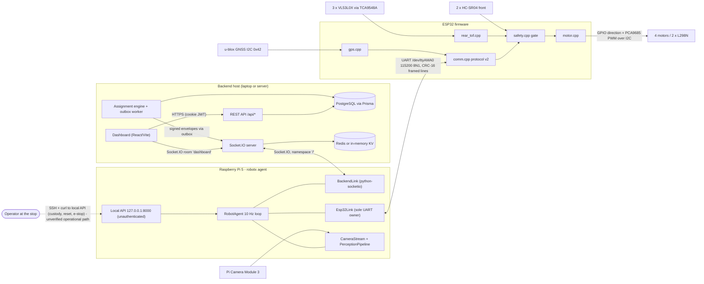
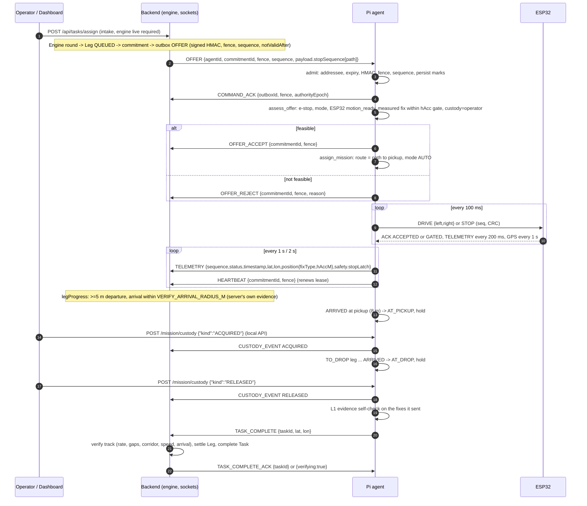
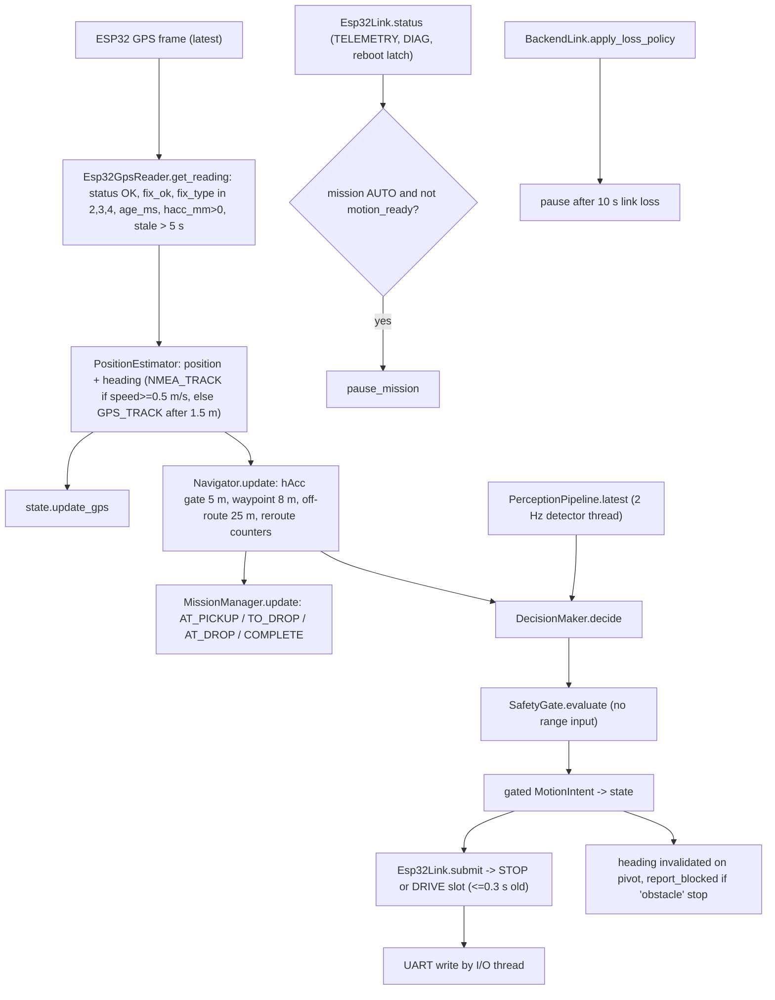
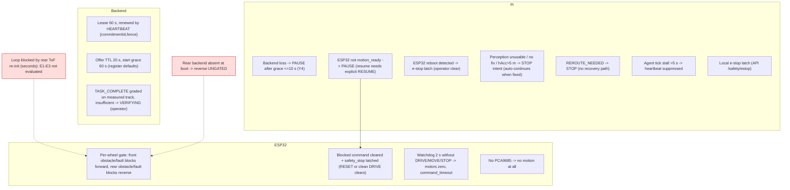

# RobotX System Architecture

Snapshot 2026-10-17 · Pi `c58f124` · ESP32 `8de2162` · Backend `de03788`. Status words follow the
vocabulary in [README.md](README.md#status-vocabulary-used-identically-in-every-document).
Relationships drawn with solid lines are established by source code. Dashed lines are
**proposed, configuration-dependent or unverified**, and are labelled.

## 1. Components

| Layer | Component | Where | Notes |
|---|---|---|---|
| Fleet | Backend API + Socket.IO server | `RobotX/Backend/server.js`, `src/app.js`, `src/sockets/socket.server.js` | Express 5, Socket.IO 4.8, Prisma 5 (PostgreSQL), optional Redis adapter |
| Fleet | Assignment engine | `RobotX/Backend/src/engine/**`, workers in `src/workers/` | Active only when `ENGINE_ENABLED=true` **and** the shard's cutover binding is on (`src/engine/cutover/enabled.js`, referenced from `task.service.js:42-44`) |
| Fleet | Physical fleet provider | `src/services/fleetProviders/physical*.js` | Off unless `PHYSICAL_FLEET_ENABLED=true` and a declaration file is configured (`physicalPolicy.js:30-32`) |
| Fleet | Dashboard | `RobotX/Frontend` (React 19, Vite 8, Mapbox GL, socket.io-client) | Operator UI. No SoC-declaration, clear-fault or custody UI found |
| Robot | Pi agent | `RobotX-Pi/robotx/**`, entry `python -m robotx.application` | FastAPI loopback API + 10 Hz agent loop + backend link + ESP32 link |
| Robot | ESP32 firmware | `robot_controller/*.ino, *.cpp, *.h` | ESP32 Dev Module, Arduino core 2.0.14 (`robot_controller.ino:5-6`) |
| Hardware | Camera | Raspberry Pi Camera Module 3 via Picamera2 | Pi-side only |
| Hardware | GPS | u-blox (named NEO-9M in `config.h:224`) on ESP32 I2C 0x42 | Polled NAV-PVT, forwarded to Pi |
| Hardware | Front range | 2 × HC-SR04 (GPIO13/14, GPIO18/19) | ESP32 only (`config.h:65-68`) |
| Hardware | Rear range | 3 × VL53L0X @0x29 behind TCA9548A @0x71, ch 0/1/2 | ESP32 only (`config.h:159-168, 491-511`) |
| Hardware | Motors | 4 motors, 2 × L298N; direction GPIO, speed via PCA9685 @0x40 CH0–3 | Differential drive, no steering (`config.h:47-55, 190-212`) |
| Hardware | Encoders | GPIO34/35/36/39 | **Reserved, not read** by firmware (`config.h:100-109`) |
| Hardware | Battery sensing | — | **None** (`robotx/hardware/battery.py:27-33` returns nulls; backend relies on operator-declared SoC) |
| Hardware | Hardware e-stop | — | **None**; backend accepts the Pi-reported *software* stop latch (`physicalPolicy.js:9-14`) |

## 2. Overall component architecture

## 3. Authority boundary: who decides what

**Design intent (verified in source):** the Pi proposes motion; the ESP32 is the final authority
over every wheel.

| Decision | Owner | Evidence |
|---|---|---|
| Which mission to accept | Backend offers; Pi decides feasibility only | `agent.py:493-537` (`assess_offer`) |
| The route | **Backend** (paths in the OFFER). The Pi never plans or edits routes | `mission/manager.py:23-29`, `mission/mission.py:1-8` |
| Desired heading, speed, steer | Pi decision layer | `control/decision.py:106-225` |
| Whether an intent may leave the Pi | Pi safety gate (e-stop latch, staleness, perception, speed ceiling) | `control/safety.py:286-343` |
| Whether a `DRIVE` is transmitted | Pi `Esp32Link` (motion enabled, link UP, PING proven, fresh TELEMETRY, no ESP32 fault) | `esp32/link.py:670-692, 827-852` |
| Whether each wheel turns | **ESP32**, every `loop()` pass: front sensors gate positive wheels, rear sensors gate negative wheels | `safety.cpp:934-958`, `robot_controller.ino:266-300` |
| Stop when the Pi goes silent | **ESP32** watchdog, 2000 ms | `robot_controller.ino:242-248`, `config.h:824` |
| Motor PWM / direction | ESP32 only; the Pi imports no motor driver in the agent path | `agent.py:14-17`; regression test `tests/unit/test_commands.py:279` |

**Deviations and caveats found:**

1. The ESP32 is not *always* in control. While `rearTofUpdate()` re-initialises a failed sensor, `loop()`
   does not run at all (see [ESP32 deep dive §8](ESP32_FIRMWARE_DEEP_DIVE.md#8-the-rear-tof-freeze-analysis)).
   Re-init is allowed only when both applied wheel outputs are zero, so motors are already stopped.
   But for the duration no command, failsafe or sensor update is processed.
2. If the TCA9548A is absent at boot, the rear gate falls back to
   `SAFETY_BLOCK_REVERSE_WHEN_REAR_UNCONFIGURED 0`. **Reverse is then ungated** (`config.h:691`,
   `safety.cpp:888-900`).
3. The Pi's gate never receives a range measurement (`agent.py:898-905`, `require_range_sensor=False`
   at `settings.py:278`). The only range-based protection is the ESP32's.
4. Stop ordering in `stopMotors()` puts an I2C write before the GPIO cutoff (`motor.cpp:243-257`).

## 4. Mission lifecycle (engine path)

Status of this path: **INTEGRATION-TESTED in software only.** Pi unit and loopback tests and the
backend's targeted tests pass, and the cross-repo signature vector reproduces. The Pi README reports a
Gate 3/3b run against the real backend with the ESP32 host simulator, which was not re-run here. No
physical end-to-end mission is evidenced.

## 5. Runtime data and control flow (one Pi tick)

ESP32 per-`loop()` order (`robot_controller.ino:185-331`): `commPoll` → set re-init permission →
`safetyUpdate` (rear ToF service, rear latch, at most one front ping per 30 ms) → `commPoll` →
MOTORTEST branch → command watchdog → `safetyGateMotion` → `driveDifferential` → `commUpdateRuntime`
→ `commServiceTelemetry` (TELEMETRY 200 ms, DIAG rotating, GPS frame 1 s) → `gpsUpdate` → `delay(1)`.

## 6. Feedback path (sensor to report)

| Step | Front ultrasonic | Rear ToF | GPS |
|---|---|---|---|
| Acquisition | `pingRaw()` `pulseIn` ≤20 ms (`safety.cpp:155-183`) | continuous mode, one sensor per 20 ms (`rear_tof.cpp:460-553`) | NAV-PVT poll 1 Hz over I2C (`gps.cpp:181-231`) |
| Filtering | 5-sample median, ≥3 good, 1 s stale, hysteresis 40/65 cm | 5-sample median, ≥3 good, 600 ms stale, hysteresis 250/400 mm | status machine, 3 s stale on ESP32 |
| ESP32 use | gates forward wheels | gates reverse wheels | **none** (reporting only, `robot_controller.ino:313-320`) |
| Serialised | TELEMETRY `front_*`, `forward_blocked` | TELEMETRY `rear_mm[]`, `rear_*`, DIAG REAR | `GPS` frame |
| Pi parser | `ControllerTelemetry.from_frame` | same | `reading_from_frame` |
| Pi use | only `front_valid` (via `safety_faults`) to refuse DRIVE / pause; health text | `rear_sensor_fault` in health text only | position, heading, navigation, offer feasibility |
| Backend | not sent (no field) | not sent | TELEMETRY `lat/lon/position`, completion evidence |

## 7. Failure handling and safety boundaries

Hard boundaries that exist in code:

- Nothing the backend does can *start* motion except an admitted OFFER or an explicit `RESUME`
  of a paused mission. Loss of the backend only reduces motion (`backend_link.py:1983-2011`).
- The Pi local API refuses `/mission/start` and `/mission/resume` whenever the backend link is enabled
  (`application/main.py:171-188`).
- `ROBOTX_ESP32_MOTION_ENABLED=0` (the default and the documented V1 value) means no `STOP` or `DRIVE`
  is ever written (`link.py:839-840`).

## 8. Telemetry, diagnostics, health

| Producer | Channel | Rate | Content |
|---|---|---|---|
| ESP32 | `TELEMETRY` | 200 ms | state, commands vs applied, front/rear ranges and gates, latches, watchdog age (`comm.cpp:1634-1681`) |
| ESP32 | `DIAG` FRONT/REAR/SYSTEM | one section every 2nd fast frame, offset 100 ms | sensor health, rear bus-error and re-init counters, link stats, proto (`comm.cpp:1683-1831`) |
| ESP32 | `GPS` | 1 s | status, fix, position, accuracy, poll counters (`gps.cpp:343-387`) |
| ESP32 | `EVENT` | on transition | READY, COMMAND_TIMEOUT, MOTORTEST_DONE, I2CSCAN |
| Pi | `/health`, `/state`, `/telemetry`, `/backend` | on request | full robot snapshot incl. controller telemetry and DIAG (`application/main.py:95-151`) |
| Pi → backend | `TELEMETRY` 1 s, `HEARTBEAT` 2 s | as listed | see [contracts](INTERFACE_AND_PROTOCOL_CONTRACTS.md#18-pi--backend-telemetry) |
| Pi → backend | `status`, `event`, `register` | **never** by default | bindings are empty strings (`communication/protocol.py:185-189`) |

## 9. Recovery and termination summary

| Situation | What happens | Who recovers |
|---|---|---|
| Backend link lost >10 s during AUTO | Pi pauses | Backend `RESUME` after reconnect (operator) |
| ESP32 telemetry stale >1 s during AUTO | Pi pauses | Explicit `RESUME` once the link is UP |
| ESP32 obstacle/fault gate | ESP32 latches; Pi pauses | Operator `/controller/reset` on Pi, then backend `RESUME` |
| ESP32 reboot | Pi e-stop latch | Operator `/safety/clear`, then `RESUME` |
| Camera obstacle ≥3 ticks | Leg stuck in `REROUTE_NEEDED` | Operator STOP (mission aborted) — no resume path |
| GPS loss / poor accuracy | Pi holds (STOP intent), mode stays AUTO | Automatic when fix returns |
| Engine WITHDRAW / RECALL / ABORT_MISSION | Pi stops that mission, tombstones commitment | n/a |
| Pi restart mid-mission | Mission state is in memory only; commitment marks persist | Leg stalls; backend timers / operator |
